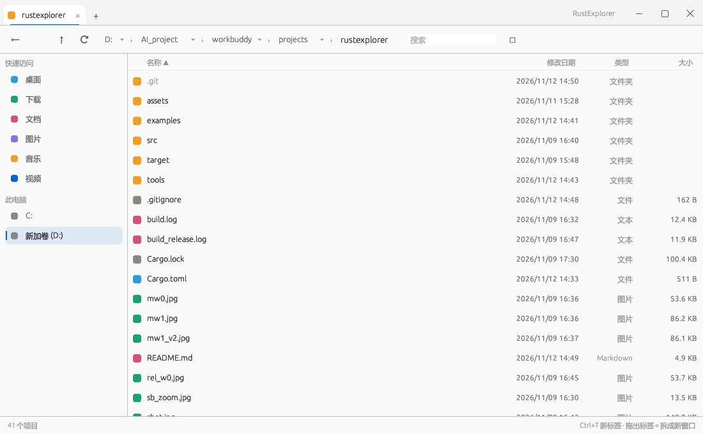

# RustExplorer

一个用 Rust + egui 写的 Windows 文件管理器：单 exe、免安装、多窗口 + 标签页。

起因很简单——Windows 自带资源管理器占内存、开多目录要靠开一堆窗口。这个项目想验证一件事：**用纯 Rust 自绘 UI，能不能做出一个体积 4 MB、启动 0.3 秒、内存 100 MB 的日常文件管理器。**



## 实测数据

| 项 | RustExplorer | explorer.exe |
|---|---|---|
| 单文件体积 | **4.1 MB**（无运行时依赖） | — |
| 启动到窗口出现 | **288 ms** | — |
| 工作集内存 | **~101 MB** | ~394 MB |
| 打开 5000 项目录 | 内存基本不变（虚拟滚动） | — |

内存大头是内嵌的微软雅黑字体与 GPU 上下文，不是目录索引——所以大目录不会拖慢它。

## 功能

**窗口与标签**

- 单进程多原生窗口；标签可拖拽重排、拖出标签栏即分离成新窗口
- 中键点标签关闭；`Ctrl+N` 新窗口、`Ctrl+T` 新标签、`Ctrl+W` 关标签、`Ctrl+1..9` 切标签
- 无边框自绘标题栏（标题与控制按钮并入标签栏同一行）、八向边缘缩放、拖拽移动

**导航**

- 后退/前进：`Alt+←/→`，以及**鼠标侧键**（下=后退，上=前进）
- 面包屑逐层跳转、`Backspace` 回上级
- 侧栏：快速访问（桌面/下载/文档/图片…）+ 此电脑盘符，显示剩余空间

**文件操作**

- 四列排序（名称/修改时间/类型/大小，文件夹恒在前）、虚拟滚动、搜索过滤、`Ctrl+A` 全选
- 双击/`Enter` 用系统默认程序打开；`F2` 重命名；`Delete` 删除到回收站（可撤销）
- `Ctrl+C/X/V` 走 **Windows 系统剪贴板（CF_HDROP）**，与资源管理器、微信、QQ 双向互通
- 拖拽：拖到文件夹行 / 侧栏 / 面包屑；从桌面或资源管理器拖入；`Ctrl` 强制复制、`Shift` 强制移动
- 复制/移动在后台线程执行，状态栏显示进度，完成后自动刷新列表

**界面**

- 浅色主题对齐 Win11 Design Tokens（`#F9F9F9` 底、`#0066D6` accent、8% 黑描边）
- 文件图标为类型着色方块（真·系统图标尚未接入）

## 快捷键

| 键 | 作用 |
|---|---|
| `Alt+←` / `Alt+→` | 后退 / 前进 |
| 鼠标侧键 下 / 上 | 后退 / 前进 |
| `Backspace` | 上一级目录 |
| `Enter` | 打开选中项 |
| `F2` | 重命名 |
| `F5` | 刷新 |
| `Delete` | 删除到回收站 |
| `Ctrl+C` / `X` / `V` | 复制 / 剪切 / 粘贴（系统剪贴板） |
| `Ctrl+A` | 全选 |
| `Ctrl+F` | 聚焦搜索框 |
| `Esc` | 清搜索 / 清选中 |
| `Ctrl+N` / `T` / `W` | 新窗口 / 新标签 / 关标签 |
| `Ctrl+1..9` | 切换标签（`9` = 最后一个） |

## 构建

需要 Rust 1.75+ 与 MSVC 工具链，只支持 Windows。

```powershell
cargo build --release
# 产物：target\release\rustexplorer.exe
```

一键发版（编译 + 编译期内嵌图标 + 把 ico 注入 PE 资源段 + 拷到 releases）：

```powershell
powershell -File tools\release.ps1
```

> 顺序不可颠倒：`cargo build` 会把注入的图标冲掉，所以 `patch_icon.py` 必须在编译之后跑。`release.ps1` 已经固定了这个顺序。

## 技术要点

- **UI**：egui / eframe 0.31，`show_viewport_immediate` 开子视口实现多原生窗口；`with_decorations(false)` + `ViewportCommand::{StartDrag, BeginResize, Minimized, Maximized, Close}` 全自绘
- **坐标系**：`ViewportInfo::inner_rect` 是**显示器坐标**，`ctx.screen_rect()` 与指针位置是**窗口内坐标**。混用会让边缘缩放手柄整体偏移、拖出标签误判——这是本项目踩过最深的一个坑
- **性能**：过滤+排序结果用 `Arc<Vec<usize>>` 缓存 + 脏标记，避免每帧 O(n log n)；列表用 `ScrollArea::show_rows` 虚拟滚动
- **剪贴板**：`GlobalAlloc(GMEM_MOVEABLE)` + `DROPFILES{fWide=1}` 写 `CF_HDROP`，配合 `Preferred DropEffect` 区分复制/剪切
- **图标**：`assets/icon_256.rgba`（256×256 裸 RGBA）用 `include_bytes!` 编进二进制，`OnceLock<Arc<IconData>>` 缓存；exe 文件图标由 `tools/patch_icon.py` 以 ctypes 调 `BeginUpdateResourceW/UpdateResourceW` 写入，不引 build.rs

## 目录结构

```
src/main.rs        UI 全量：tokens、多视口调度、标签栏、列表、菜单、快捷键
src/fs_util.rs     文件系统：目录枚举、回收站、系统剪贴板、后台复制/移动任务
assets/            图标源文件（png / ico / 裸 rgba）
tools/             图标生成、PE 资源注入与校验、发版脚本、剪贴板互通验证
examples/          一次性验证程序（cliptest：剪贴板读写互通测试）
```

## 已知限制

- 拖出窗口到外部程序未实现（需 OLE `IDataObject` + `SHDoDragDrop`）
- 粘贴遇到同名文件采用覆盖策略，暂无"覆盖/跳过/重命名"对话框
- 目录不会自动刷新（需 `F5`）；盘符列表只在启动时枚举，热插拔需重启
- 尚未接入系统文件图标（`SHGetFileInfoW`）
- 无会话持久化：窗口尺寸、标签、排序每次重启重置

## 许可证

[MIT](LICENSE)
