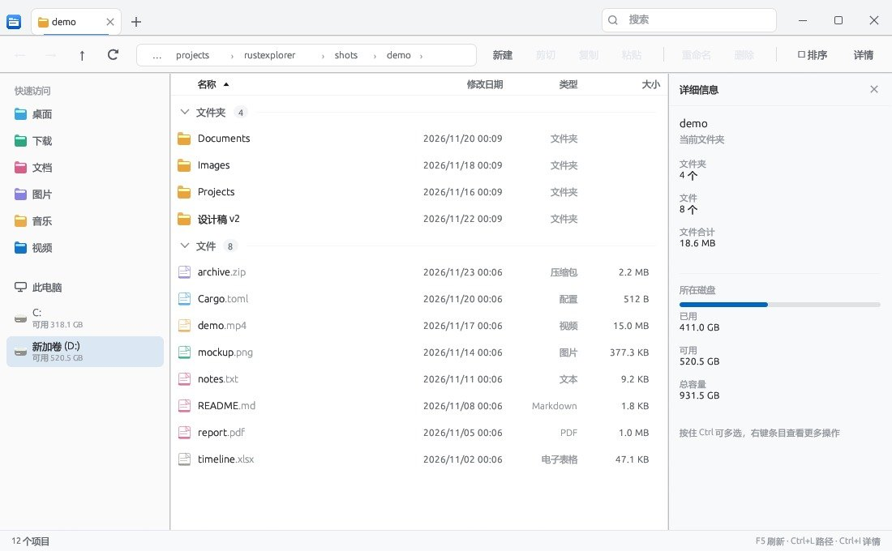
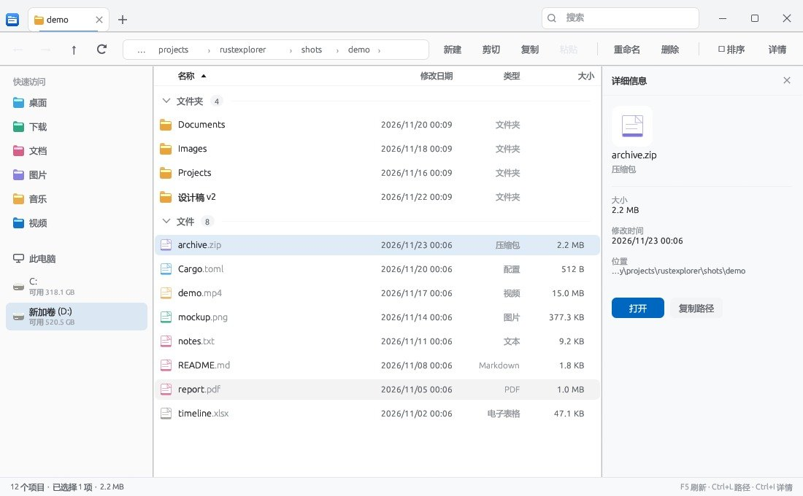
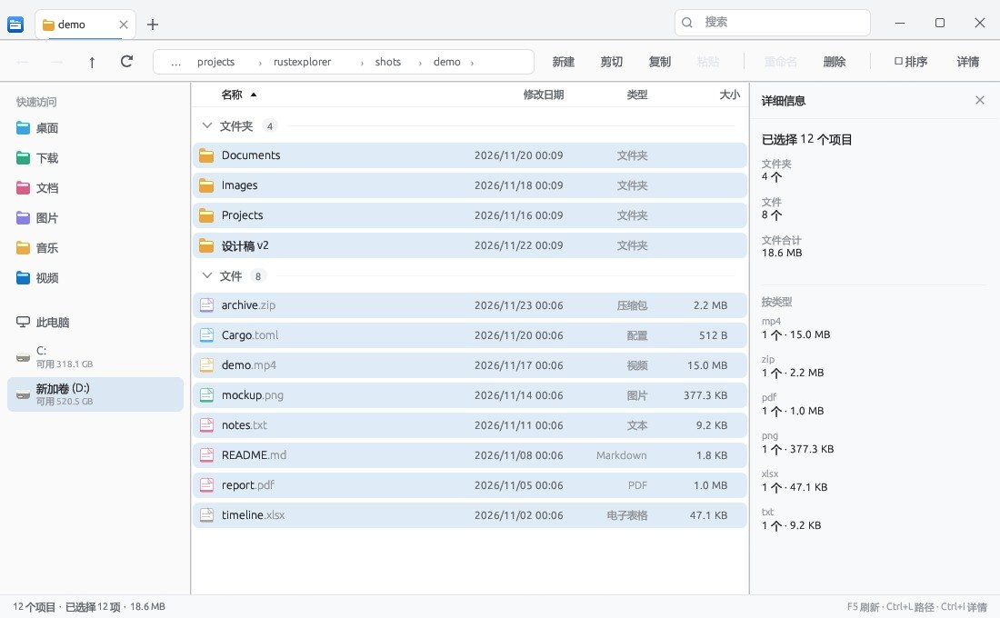
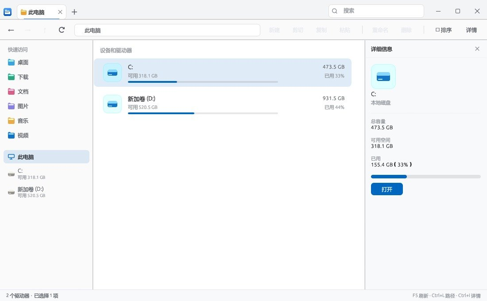
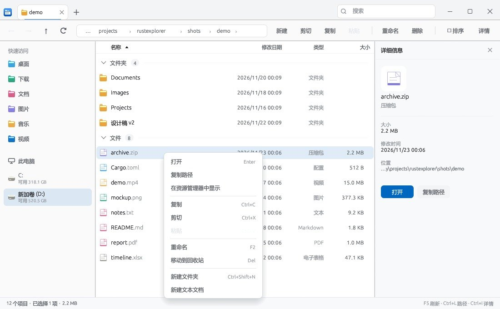

# RustExplorer

一个用 Rust + egui 写的 Windows 文件管理器：单 exe、免安装、多窗口 + 标签页。

起因很简单——Windows 自带资源管理器占内存、开多目录要靠开一堆窗口。这个项目想验证一件事：**用纯 Rust 自绘 UI，能不能做出一个体积 4 MB、启动 0.25 秒、内存 90 MB 的日常文件管理器。**



> 不想自己编译的话，[Releases](https://github.com/songjiahao-wq/rustexplorer/releases) 里有编译好的 exe，下载双击即用。

## 实测数据

| 项 | RustExplorer | explorer.exe |
|---|---|---|
| 单文件体积 | **4.0 MB**（无运行时依赖） | — |
| 启动到窗口出现 | **≈250 ms** | — |
| 工作集内存 | **~91 MB** | ~394 MB |
| 打开 5000 项目录 | 内存基本不变（虚拟滚动） | — |

内存大头是内嵌的微软雅黑字体与 GPU 上下文，不是目录索引——所以大目录不会拖慢它。

## 界面

视觉参照的是现代 Windows 应用的设计语汇（[Argus](https://github.com/Ray-lea/Argus) 的任务管理器给了很多启发）：**发丝线分区而不是卡片堆叠、紧凑标题栏内嵌搜索、数字与次要信息右对齐、能折叠的分组表格、常驻右侧详情面板**。全部用 egui 手绘，没有图片资源。

| 单选：规格与操作 | 多选：统计与类型分布 |
|---|---|
|  |  |

| 此电脑：驱动器容量 | 右键菜单：分组 + 快捷键提示 |
|---|---|
|  |  |

## 功能

**窗口与标签**

- 单进程多原生窗口；标签可拖拽重排、拖出标签栏即分离成新窗口
- 中键点标签关闭；`Ctrl+N` 新窗口、`Ctrl+T` 新标签、`Ctrl+W` 关标签、`Ctrl+1..9` 切标签
- 无边框自绘标题栏：应用图标 + 标签胶囊（当前标签带强调色指示条）+ 内嵌搜索框 + 窗口按钮同一行，八向边缘缩放、空白处拖拽移动

**导航**

- 后退/前进：`Alt+←/→`，以及**鼠标侧键**（下=后退，上=前进）
- 面包屑逐层跳转，宽度不够时从尾部往前折叠成 `…`；`Ctrl+L` 把面包屑切成地址栏直接输路径（`Enter` 跳转、`Esc` 取消）
- 侧栏：快速访问（桌面/下载/文档/图片…）+ 此电脑（卷标 + 剩余空间，两行）
- `Backspace` 回上级；`F5` 刷新

**列表**

- 文件夹/文件两个**可折叠分组表头**，带计数胶囊；组头点击折叠，全选/方向键只在可见项里走
- 四列排序（名称/修改时间/类型/大小，文件夹恒在前），列头箭头指示方向
- 行高 30 px、虚拟滚动，几万项目录也不卡
- 搜索过滤（标题栏内嵌，`Ctrl+F` 聚焦），状态栏显示「N 项匹配（共 M 项）」
- 图标是按类型着色的矢量图形（文件夹/磁盘/文件三套，扩展名决定配色）

**详情面板**（`Ctrl+I` 开关，默认常开）

- 单选：56 px 图标块 + 名称 + 类型 + 大小/修改时间/位置（路径从左截断，优先保住尾部）+ 打开/复制路径
- 多选：计数、文件夹/文件/文件合计、按类型 Top 4 分布
- 无选中：当前文件夹统计 + 所在磁盘容量条
- 此电脑：驱动器数量、总容量/可用汇总，以及每个盘的容量条与已用占比

**此电脑**

- 驱动器列表：图标块、卷名、可用空间、容量条、总容量与已用占比右对齐
- 单击选中（右侧显示该盘明细），双击或 `Enter` 进入

**文件操作**

- 双击/`Enter` 用系统默认程序打开；`F2` 重命名（预选文件名主体，不含扩展名）；`Delete` 删除到回收站（可撤销）
- `Ctrl+Shift+N` 新建文件夹，右键可新建文本文档
- `Ctrl+C/X/V` 走 **Windows 系统剪贴板（CF_HDROP）**，与资源管理器、微信、QQ 双向互通
- 拖拽：拖到文件夹行 / 侧栏 / 面包屑；从桌面或资源管理器拖入；`Ctrl` 强制复制、`Shift` 强制移动
- 复制/移动在后台线程执行，状态栏显示进度，完成后自动刷新列表
- 右键菜单按「打开 / 剪贴板 / 修改 / 新建」分组，右对齐标出快捷键；排序菜单用强调色 + 箭头标当前项

## 快捷键

| 键 | 作用 |
|---|---|
| `Alt+←` / `Alt+→` | 后退 / 前进 |
| 鼠标侧键 下 / 上 | 后退 / 前进 |
| `Backspace` | 上一级目录 |
| `Enter` | 打开选中项 |
| `F2` | 重命名 |
| `F5` | 刷新 |
| `Delete` | 删除到回收站 |
| `Ctrl+C` / `X` / `V` | 复制 / 剪切 / 粘贴（系统剪贴板） |
| `Ctrl+A` | 全选（只选可见项） |
| `Ctrl+F` | 聚焦搜索框 |
| `Ctrl+L` | 编辑地址栏（输入路径直达） |
| `Ctrl+I` | 显示/隐藏详情面板 |
| `Ctrl+B` | 显示/隐藏侧栏 |
| `Ctrl+Shift+N` | 新建文件夹 |
| `Esc` | 关菜单 / 清搜索 / 清选中 |
| `Ctrl+N` / `T` / `W` | 新窗口 / 新标签 / 关标签 |
| `Ctrl+1..9` | 切换标签（`9` = 最后一个） |

## 构建

需要 Rust 1.75+ 与 MSVC 工具链，只支持 Windows。

```powershell
cargo build --release
# 产物：target\release\rustexplorer.exe
```

一键发版（编译 + 编译期内嵌图标 + 把 ico 注入 PE 资源段 + 拷到 releases）：

```powershell
powershell -File tools\release.ps1
```

连 GitHub Release 一起发（自动读 `Cargo.toml` 版本号建 tag、打附件、写发布说明）：

```powershell
powershell -File tools\release.ps1 -Release
powershell -File tools\release.ps1 -Release -Notes docs\v0.2.0.md   # 自定义发布说明
```

> 顺序不可颠倒：`cargo build` 会把注入的图标冲掉，所以 `patch_icon.py` 必须在编译之后跑。`release.ps1` 已经固定了这个顺序。
>
> 发 Release 走本地代理（默认 `http://127.0.0.1:20172`，带分流规则那个端口），可用 `-Proxy` 覆盖。另外中文说明一律走 UTF-8 文件传参，别当命令行参数塞给 git/gh，会被按 GBK 转坏。

## 技术要点

- **UI**：egui / eframe 0.31，`show_viewport_immediate` 开子视口实现多原生窗口；`with_decorations(false)` + `ViewportCommand::{StartDrag, BeginResize, Minimized, Maximized, Close}` 全自绘
- **坐标系**：`ViewportInfo::inner_rect` 是**显示器坐标**，`ctx.screen_rect()` 与指针位置是**窗口内坐标**。混用会让边缘缩放手柄整体偏移、拖出标签误判——这是本项目踩过最深的一个坑
- **命令条防溢**：右侧命令组先用 `right_to_left` 子 UI 排完，取它的 `min_rect().min.x` 反推地址栏可用宽度。用「估算宽度预留」的写法在实际内边距下必然算不准，按钮会压到地址栏上
- **面板分隔线**：半透明描边画在面板接缝处，底下是窗口清屏色（黑），会混成一条近黑线。正解是 `clear_color` 返回白色 + 在 `Order::Middle` 层用**不透明**浅灰画 1 px 线
- **列对齐**：所有列锚点统一用「右边界」记账（`r_size → r_type → r_date`），表头与数据单元格共用同一套坐标，避免出现「类型/大小」叠字
- **文件名两段式**：一个 `LayoutJob` 里主体用前景色、扩展名用浅灰，按真实字宽排列——按字符数估算宽度会导致重叠或漏缝
- **弹层**：菜单用 `egui::Area` + 固定条目宽，不用 `Window`（`Window` 默认可缩放，会被 `available_width` 撑成一整块空白）；锚点贴边时做窗口内收
- **性能**：过滤+排序结果用 `Arc<Vec<usize>>` 缓存 + 脏标记，避免每帧 O(n log n)；列表用 `ScrollArea::show_rows` 虚拟滚动
- **剪贴板**：`GlobalAlloc(GMEM_MOVEABLE)` + `DROPFILES{fWide=1}` 写 `CF_HDROP`，配合 `Preferred DropEffect` 区分复制/剪切
- **图标**：界面图标全部是 `Painter` 手绘矢量（矩形/圆角/折线/多边形），零图片资源、任意 DPI 清晰；exe 文件图标由 `assets/icon_256.rgba` 用 `include_bytes!` 编进二进制（`OnceLock` 缓存纹理），再用 `tools/patch_icon.py` 以 ctypes 调 `BeginUpdateResourceW/UpdateResourceW` 写进 PE 资源段，不引 build.rs

## 目录结构

```
src/main.rs        UI 全量：tokens、多视口调度、标签栏、命令条、列表、详情面板、菜单、快捷键
src/view.rs        绘制原语：矢量图标、发丝线、胶囊、容量条、按钮、输入框外观
src/fs_util.rs     文件系统：目录枚举、磁盘容量、回收站、系统剪贴板、后台复制/移动任务
assets/            图标源文件（png / ico / 裸 rgba）
tools/             图标生成、PE 资源注入与校验、发版脚本、剪贴板互通验证、抓帧脚本
examples/          一次性验证程序（cliptest：剪贴板读写互通测试）
```

## 已知限制

- 拖出窗口到外部程序未实现（需 OLE `IDataObject` + `SHDoDragDrop`）
- 粘贴遇到同名文件采用覆盖策略，暂无"覆盖/跳过/重命名"对话框
- 目录不会自动刷新（需 `F5`）；盘符列表只在启动时枚举，热插拔需重启
- 未接入系统文件图标（`SHGetFileInfoW`），用的是自绘类型图标
- 无会话持久化：窗口尺寸、标签、排序每次重启重置

## 许可证

[MIT](LICENSE)
